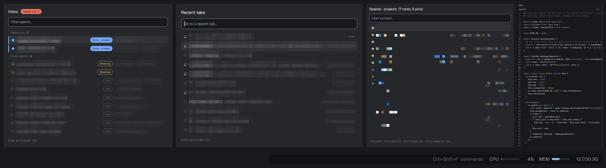

# All-in-one

Everything in this repo at once: Herdr's main window with a CPU / memory meter in the status bar, the Inbox, Recent and Projects popups on keys, and the Viewer for Ctrl/Cmd-clicked paths and web addresses. Optionally the author's keymap too. This folder holds only the layout. The mods come from the other folders of this repo, so there is one copy of each.



## What you see

- Herdr's shipped `main` window (0.1.17), unchanged except for the status bar.
- **Status bar** (28px row), from left to right:
  - The shipped `workspace-status`, taking the remaining width.
  - The CPU / MEM meter, 300px wide ([`sysmon-status`](../sysmon-status/RECIPE.md)).
  - A 0px block running `recent`'s visit tracker. It draws nothing.
- **Popups**, each opened by a key:
  - Inbox: every agent, the ones that need you first ([`inbox`](../inbox/RECIPE.md)).
  - Recent: tabs in the order you last looked at them ([`recent`](../recent/RECIPE.md)).
  - Projects: switch spaces or open a project folder ([`projects`](../projects/RECIPE.md)).
- **Viewer:** a pane beside the terminal after a Ctrl/Cmd-click on a path or a web address ([`viewer`](../viewer/RECIPE.md)).

## How it behaves

Each piece behaves as its own recipe says. Together:

- The meter updates every 2 s. It is Linux only: on macOS and Windows the install leaves it out.
- Recent records every tab you look at while this layout is shown. Switching to a layout without the 0px block stops recording.
- The layout's root has `"link_handlers": ["viewer"]`, so Ctrl/Cmd-clicks in terminals go to the viewer first.
- **Keys**, whichever set the person picks at install:
  - Suggested by each mod: `alt-2` Inbox, `alt-e` Recent, `alt-1` and `ctrl-shift-j` Projects. `alt-1` and `alt-2` replace Herdr's default `space.select:1`/`2`.
  - The author's [keymap](../keymap/README.md): `alt-2` Inbox, `ctrl-e` Recent, `alt-1` and `ctrl-shift-j` Projects, and pane, tab and `ctrl-b` keys.

## Built from

- **`layouts/all-in-one.json`:** Herdr 0.1.17's shipped `main.json` with two changes.
  1. The `status` block (`{ "mod": "workspace-status" }`, 28px) became a row. Its first child is the shipped block, given the id `status-base`; the row has no `divider`.
     ```json
     { "id": "status", "type": "row", "size": { "px": 28 }, "children": [
         { "id": "status-base", "type": "block", "content": { "mod": "workspace-status" } },
         { "id": "status-sysmon", "type": "block", "size": { "px": 300 }, "content": { "mod": "sysmon" } },
         { "id": "status-recent", "type": "block", "size": { "px": 0 }, "content": { "mod": "recent" } } ] }
     ```
  2. The root has `"link_handlers": ["viewer"]`.
- **Mods**, each copied from its folder in this repo (not from this folder):
  - `sysmon-status/mods/sysmon`
  - `inbox/mods/inbox`
  - `recent/mods/recent`
  - `projects/mods/projects`
  - `viewer/mods/viewer`
- **Keys:** either merge `inbox/keys.json`, `recent/keys.json` and `projects/keys.json`, or merge `keymap/keys.json` instead.
- It uses no shipped mod beyond `main`'s own. It has no art of its own.

### Installing it (read this first)

This folder has no `mods/`, so the usual steps in `AGENTS.md` (in the Herdr home: `~/.config/herdr-app`, or `$HERDR_APP_HOME`) need the other folders too:

1. **Requirements.** Check them and tell the person what's missing before copying anything. Ask whether to go on without it, and don't install programs yourself.
   - `herdr-app --version` must be 0.1.17 or newer, for the viewer's link handlers.
   - For the viewer: Node 22+, `git`, and Chrome, Chromium or Edge (see its recipe).
   - On macOS or Windows (check with `uname` or the OS you run on), don't ask: leave out the `sysmon` mod and remove the `status-sysmon` block from the layout's status row. The meter would only be an empty 300px strip there. Tell the person you left it out.
2. **Read every file** of this folder and of the five mod folders above. Tell the person what runs programs, reads files outside its folder or reaches the network:
   - `projects` reads and writes `projects.json` in the Herdr home (shared with any other copy of it), and runs `find` or PowerShell only when it can't list a folder itself.
   - `viewer` runs `node`, `git`, a headless browser and the system opener, and loads the web pages you click.
   - `sysmon` reads `/proc` (Linux only).
   - `inbox` and `recent` use Herdr's data and the shipped `mods/workspace-chrome/spinner.svg`; `recent` writes its visit list to Herdr's shared state.
3. **Copy** `layouts/all-in-one.json` and the five mod folders into the Herdr home. Never overwrite.
   - When a name is taken, rename the new copy and update `"mod"` in the layout, `link_handlers`, and the renames each mod's recipe lists.
   - `recent` has its shared key `recent.tabs`.
   - `viewer` has `mods/viewer/`, `data/viewer/`, `viewer.show`, `viewer.clicks`, and in `link.js` both `mod: "viewer"` and the `p.mod === "viewer"` test.
4. **Keys.** Ask which set the person wants: the three suggested keys, or the author's keymap. Merge it, ask before replacing any key already in use, and point `mod.open:` at the installed names.
   - If mods were renamed because older copies exist, the existing keys still open the old copies. Ask whether to move those keys to the new copies, or which new keys to use.
   - Recent's popup and its tracker must be the same copy: a renamed tracker writes its own history, so a key that opens the old popup won't show it.
5. **Check and switch.** `herdr-app check <Herdr home>/mods/<installed name>` for each mod, then `layout.switch {"name":"all-in-one"}`. The person's own layout stays; switching back is `layout.switch` with its name (the author's keymap moves `ctrl-shift-l` away from layout switching).

## Watch out

- Herdr only lets link handlers run on a personal layout. This file is one once copied into `layouts/`, so the viewer works without cloning `main`.
- The layout is a copy of 0.1.17's `main`. Later Herdr updates to `main` don't reach it. To pick them up, clone the new `main` and apply the two changes above again.
- The `recent` block must stay in the layout, or nothing records visits.
- Installing only some of the mods is fine. Drop the blocks and keys of the ones left out, and remove `link_handlers` if `viewer` is left out.
- Tested on Linux with Herdr 0.1.17. macOS and Windows are untested.

## Done when

- `herdr-app check` passes for `inbox`, `recent`, `projects` and `viewer`, and on Linux `sysmon` (or their installed names).
- On Linux, after `layout.switch {"name":"all-in-one"}`, the status bar shows `CPU` and `MEM` meters on the right. On macOS and Windows, the layout has no `status-sysmon` block and no `sysmon` mod was copied.
- The chosen Inbox, Recent and Projects keys open the installed copies' popups.
- Visit tab A, then tab B, then open Recent: B is the first row and the cursor is on A.
- Ctrl/Cmd-clicking a file path in a terminal opens it in a viewer pane to the right.
