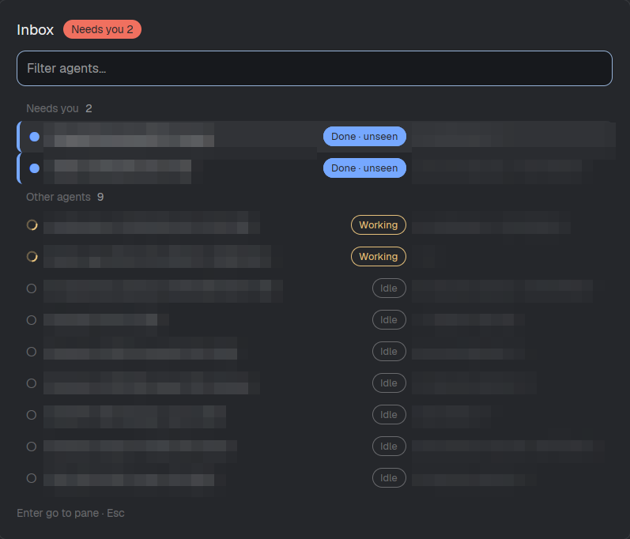

# Inbox

A keyboard-first popup listing every agent: first the ones that need you, then the rest. Type to filter, move with the arrow keys, press Enter to jump to that agent's pane.

## What you see

- A popup at the top of the window, 40px down, 640px wide, up to 80% of the window height. Its background is `popover`, with 18px padding, a 10px gap and 13px text.
- **Header:** `Inbox` (15px, semibold, `foreground`), then either:
  - a filled pill `Needs you N` (11px semibold, `blocked` background, `popover` text, radius 10), or
  - `Nothing waiting` in `dim` when no agent needs you.
- **Filter box:** 36px tall, radius 9, 1px `accent` border, `background` fill, placeholder `Filter agents…`. It has focus as soon as the popup opens.
- **List**, in up to two sections, each with a 26px header in 11px semibold `dim` plus the count in `muted`:
  - `Needs you N`: agents that are blocked (waiting for input) or done (finished while you weren't looking).
  - `Other agents N`: the rest.
- **Rows** are 32px tall, radius 7, with 10px side padding. From left to right:
  - **Status glyph, 12px wide:** working is the shipped spinner (`mods/workspace-chrome/spinner.svg`, spinning every 900ms, `working`). Idle is `○` in its status color. Any other status is `●` in its status color.
  - **Title:** the agent's title, or its program's name, or its address. It truncates.
  - **Badge:** 10.5px semibold, radius 10, 1px border in the status color. Labels are `Needs input`, `Done · unseen`, `Working` and `Idle`.
  - **Location:** `space / tab` in a 190px box, 11px, `dim`, truncated.
- **Rows that need you** have a 3px left border in their status color (`blocked` or `done`), a semibold `foreground` title and a filled badge (status color background, `popover` text). Other rows have a `muted` title and an outline badge.
- The selected row and the hovered row have the `hover` background.
- **Footer:** `Enter go to pane · Esc` (11px, `dim`). With no agents, `No agents` replaces the list.

## How it behaves

- **Order:** blocked before done, newest first (higher `seq`) inside each status. Then every other agent, newest first.
- **Filter:** split what you typed on whitespace. A row stays if every word appears, ignoring case, in its title, space name or tab name. Typing moves the selection back to the first row.
- **Keys:** ↑/↓ move the selection and wrap around at both ends, keeping the selected row scrolled into view. Enter or a click closes the popup and runs `agent.focus` for that agent. Esc closes the popup.
- **Opening:** `alt-2` opens it (from `keys.json`). Without that key, use `mod.open {"name":"inbox"}`, with the name it was installed under.
- The list updates live as agents change status, with no timer.

## Built from

- **`mods/inbox/mod.json`:** `place: "none"`, title `Inbox`, and the overlay `{ "kind": "popup", "at": "top", "offset": 40, "width": 640, "height": 0.8 }`.
- **`main.js`**, a `View`:
  - `herdr`: `agents()`, `run("agent.focus", { terminal })`, `props().overlay`, `closeOverlay`, `theme()`.
  - `gpui-base`: `InputState` / `Input` for the filter, `ScrollHandle` for the list, `v_flex` / `h_flex`.
  - Keys are handled in `on_key_down` on the focus-tracked root. Submit comes from the input's `submit` event.
- **`keys.json`:** `{ "global": { "alt-2": "mod.open:inbox" } }`. Merge it into yours, pointing at the installed name if the mod was renamed.
- It doesn't call `exec` or `hc`, doesn't reach the network, and reads no files of its own. Its only art is the shipped spinner, `mods/workspace-chrome/spinner.svg`.

## Watch out

- Popups size to their content. Give the list a definite height (`min(500, rows × 32 + headers × 26)`), or it collapses to 0.
- The scroll index counts the section header rows. The selected row's index in the scroll list is its row index plus the headers above it.
- Focus the input in `init` and once more 600ms later. Opening the overlay can take focus back from the first call.
- "Done" is Herdr's status for an agent that finished while you weren't looking. It turns idle once you've seen it, so the row moves to `Other agents` by itself.
- `alt-2` is `space.select:2` in Herdr's default keys, and may already be bound in your `keys.json`. Pick another key rather than replacing one you use. On macOS, `alt-2` is Option+2, which some keyboard layouts use to type a character.

## Done when

If the mod was renamed on install (its name was taken), use the installed name below.

- `herdr-app check mods/inbox` passes.
- `alt-2` opens the popup with the filter focused.
- When an agent is blocked, it is listed first under `Needs you`, with a red edge and a filled `Needs input` badge, and the header pill counts it.
- Typing part of a space name filters the list. ↓ past the last row wraps to the first.
- Enter on a row closes the popup and focuses that agent's pane. Esc closes it without moving.
