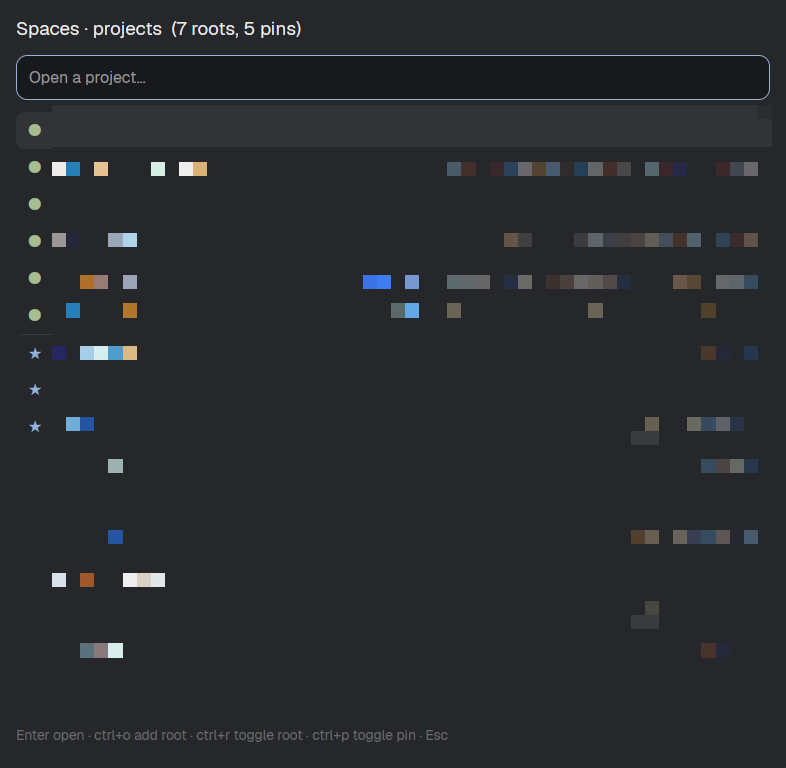

# Projects

One popup to switch spaces and to open projects: the spaces you have open come first, then every folder under the project roots you chose, and pinned folders. Type to filter, Enter goes to the space or opens the folder as a new one.

## What you see

- A popup at the top of the window, 40px down, 640px wide, up to 80% of the window height. Its background is `popover`, with 18px padding, a 10px gap and 13px text.
- **Header:** `Spaces · projects  (N roots, M pins)` (15px, semibold, `foreground`), and on the right a `+ Add root` button.
- **Buttons** (here and on the selected row): 24px tall, radius 6, 8px side padding, 1px `border`, `background` fill, `raised` on hover, an 11.5px `foreground` label and its key in 10.5px `dim` (`Ctrl+O`, `Ctrl+P`, `Ctrl+R`).
- **Filter box:** 36px tall, radius 9, 1px `accent` border, `background` fill, placeholder `Open a project…`. It has focus as soon as the popup opens.
- An error line in `blocked` (11.5px), when `projects.json` can't be parsed or a save lost a race (the list is reread and the message stays). Non-array `roots` or `pins` count as empty.
- **List:** at most 480px tall, rows 30px tall, radius 7, 10px side padding and gap. A 1px `border` line separates open spaces from folders.
  - **Open space:** a green `●` (`ansi2`), then the space name (semibold for the shown space). Next comes `Needs input` (`blocked`) or `Done · unseen` (`done`) at 11px when the space needs you. Last is `N tabs · <folder>` in 11px `dim`, with `~` for the home folder, at most 220px and truncated.
  - **Folder:** `★` in `accent` when pinned, else a 12px gap. Then the folder name (`foreground`, truncates), a `root` tag (10.5px, 1px `border`, radius 4, `dim`) when it is a root, and its parent path (11px `dim`, at most 220px, truncated).
  - **The selected row** (spaces and folders) ends with two buttons: `Pin` / `Unpin` (`Ctrl+P`) and `Make root` / `Remove root` (`Ctrl+R`).
  - The selected row and the hovered row have the `hover` background.
- When nothing is listed, the list area shows one of: `Scanning…`, `No project matches`, or `No roots yet: + Add root (Ctrl+O) to list your project folders`.
- **Footer** (11px, `dim`): `↑↓ move · Enter open · Esc close`, starting with `Scanning… · ` while folders are being read.

## How it behaves

- **Order:**
  1. Open spaces, in sidebar order.
  2. Pinned folders.
  3. Each root followed by the folders directly under it, sorted by name.

  A folder that is already an open space's folder is listed only once, as the space. Hidden folders (`.git`, `.cache`) are left out.
- **Cursor:** it opens on the shown space, so one ↑ or ↓ reaches the neighbouring space. ↑/↓ wrap around at both ends.
- **Filter:** split what you typed on whitespace. A row stays if every word appears, ignoring case, in the space name and folder, or in the folder path. Typing moves the cursor to the first row.
- **Enter or a click** closes the popup, then:
  - `space.select` when the row is an open space.
  - Otherwise `space.new {name: <folder name>, folder, machine: ""}`. The new space is on this computer.
- **`+ Add root` or ctrl+o** opens the system folder picker and adds the picked folder as a root. **The row's root button or ctrl+r** toggles the selected folder as a root. **Its pin button or ctrl+p** toggles its pin. Each change is saved to `projects.json` and the list is reread.
- Pressing a button doesn't open the row: the button stops the press (`on_mouse_down` + `on_click` with `stop_propagation`).
- **Esc** closes the popup.
- **Opening:** `ctrl-shift-j` opens it (from `keys.json`). Without that key, use `mod.open {"name":"projects"}`, with the name the mod was installed under.

## Built from

- **`mod.json`:** `place: "none"`, title `Projects`, and the overlay `{ "kind": "popup", "at": "top", "offset": 40, "width": 640, "height": 0.8 }`.
- **`projects.json`** in Herdr's home (`appHome()`): `{"roots": [...], "pins": [...]}`.
  - On Linux and macOS, paths under the home folder are stored as `~/a/b`. Other paths, and every path on Windows, are stored in full: Windows `home()` can be a profile's Documents or a network share, so a saved `~` could point elsewhere later.
  - The file is created on the first ctrl+o, ctrl+r or ctrl+p.
  - Saves use `writeTextFile(path, text, expected)` with the text read last, so an edit made elsewhere in the meantime is not overwritten: the list reloads instead.
- **Listing folders:**
  - On Linux and macOS it uses `readdir(dir, {withFileTypes: true})` from the mod's `fs/promises`, which reads only inside the home folder. When that fails (a root in `/srv`, a permission error), it runs `find <dir> -mindepth 1 -maxdepth 1 -type d`.
  - On Windows it always runs PowerShell, as Herdr's own Files panel does: `[Console]::OutputEncoding = UTF-8; Get-ChildItem -LiteralPath '<dir>' -Directory -Force`. The path goes inside the script as a quoted literal, with `'` and curly quotes doubled: arguments after `-Command` are joined into the script, not passed as `$args`.
  - Each folder gets 10 s, one after another.
  - A pin or root that can't be listed is skipped.
- **The platform:** `window()` is null outside a window (`herdr-app check`), so the platform is told from `home()`: a drive letter (`C:`) means Windows.
- **`herdr`:** `spaces()`, `home()`, `appHome()`, `readTextFile`, `writeTextFile`, `pickFolder`, `exec` (PowerShell on Windows, `find` when `readdir` fails elsewhere), `run("space.select" | "space.new")`, `props().overlay`, `closeOverlay`, `theme()`.
- **`gpui-base`:** `InputState`/`Input` for the filter, `ScrollHandle` for the list.
- **`keys.json`:** `{ "global": { "ctrl-shift-j": "mod.open:projects" } }`. Merge it into yours, pointing at the installed name if the mod was renamed.
- **What it reaches:** no network. It reads only your roots' and pins' folder names and its own `projects.json`.

## Watch out

- Popups size to their content. Give the list a definite height (`min(480, rows × 30)`), or it collapses to 0.
- Focus the input in `init` and once more 600ms later. Opening the overlay can take focus back from the first call.
- `fs/promises` refuses paths outside the home folder, so roots elsewhere need the `find` fallback.
- `pickFolder` takes no starting folder: the system picker opens where the OS chooses (Documents on Windows).
- Spaces opened from here are always on this computer (`machine: ""`), and only local folders are listed. Open spaces on other machines are listed too; a local folder with the same path as one of them is hidden behind it.
- Installed twice under two names, both copies share one `projects.json`.
- `ctrl-shift-j` is free in Herdr's default keys. On macOS you may prefer a `cmd` key.
- Tested on Linux. The Windows and macOS paths (the separator, the PowerShell fallback) are written but untested.

## Done when

- `herdr-app check mods/projects` passes.
- `ctrl-shift-j` opens the popup with the filter focused and the cursor on the shown space.
- `+ Add root` (or ctrl+o), pick a folder under your home folder that isn't open as a space: it appears with a `root` tag, followed by the folders under it, and `projects.json` lists it as `~/…`.
- Type part of a folder name and press Enter: a new space opens there. Open the popup again: that folder is now listed under open spaces.
- `Pin` on the selected folder adds a `★` and the button reads `Unpin`; pressing it again removes the star. ctrl+p does the same.
