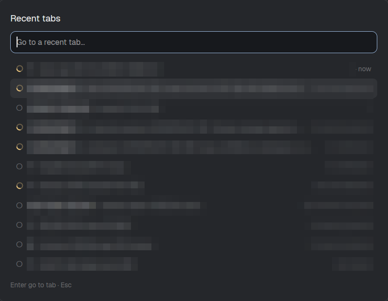

# Recent

A popup of your tabs in the order you last looked at them. It opens with the cursor on the tab you were on before this one, so the key and then Enter flips between your last two tabs. Type to jump to any other.



## What you see

- A popup at the top of the window, 40px down, 640px wide, up to 80% of the window height. Its background is `popover`, with 18px padding, a 10px gap and 13px text.
- **Header:** `Recent tabs` (15px, semibold, `foreground`).
- **Filter box:** 36px tall, radius 9, 1px `accent` border, `background` fill, placeholder `Go to a recent tab…`. It has focus as soon as the popup opens.
- **Rows** are 32px tall, radius 7, with 10px side padding and a 10px gap. One row per tab, in every space. From left to right:
  - **Status glyph, 12px wide, for the tab's status:** working is the shipped spinner (`mods/workspace-chrome/spinner.svg`, spinning every 900ms, `working`). Blocked and done are `●` in their status color. Anything else is `○` in `dim`.
  - **Tab name:** `foreground`, at most 220px, truncated. The tab you're on is semibold.
  - **Agent titles:** the titles of the agents in that tab joined with ` · `, 11.5px, `muted`. They fill the remaining width and truncate.
  - **Space name:** 11px, `dim`. The tab you're on reads `<space> · now`.
- The selected row and the hovered row have the `hover` background.
- **Footer:** `Enter go to tab · Esc` (11px, `dim`). With no tabs, `No tabs` replaces the list.

## How it behaves

- **Order:** tabs you've visited come first, most recent first. The other tabs follow in sidebar order (space, then tab).
- **Cursor on open:** if the first row is the tab you're on, the cursor starts on the second row. Otherwise it starts on the first.
- **Filter:** split what you typed on whitespace. A row stays if every word appears, ignoring case, in the tab name, the space name or the agent titles. Typing moves the cursor to the first row.
- **Keys:** ↑/↓ move the cursor and wrap around at both ends. Enter or a click closes the popup and runs `tab.select` for that tab. Esc closes it.
- **Opening:** `alt-e` opens it (from `keys.json`). Without that key, use `mod.open` with the name the mod was installed under.
- **Visit history:** it updates whenever focus moves to another tab. It keeps the last 100 tabs and survives restarts.

## Built from

- **One mod, two roles.** `init` checks `props().overlay`:
  - **Tracker:** without an overlay, the copy is the tracker. Its `render` reads `focused().tab`. If that tab isn't already first in the shared value `recent.tabs`, it moves the tab to the front (`setShared`, capped at 100 ids). Then it returns an empty `div()`. Herdr re-renders it on every focus change, so it needs no timer.
  - **Popup:** with an overlay, the copy is the popup.
- **The tracker has to sit in the layout** as a 0px block, for example in the status bar. In the shipped `main`, the `status` node is a block. Turn it into a row that keeps the shipped segment and adds the tracker:
  ```json
  { "id": "status", "type": "row", "size": { "px": 28 }, "children": [
      { "id": "status-base", "type": "block", "content": { "mod": "workspace-status" } },
      { "id": "status-recent", "type": "block", "size": { "px": 0 }, "content": { "mod": "recent" } } ] }
  ```
  Any row or column in your layout works; the block just has to be there.
- **`mod.json`:** `place: "none"`, title `Recent`, and the overlay `{ "kind": "popup", "at": "top", "offset": 40, "width": 640, "height": 0.8 }`.
- **APIs used:**
  - `herdr`: `spaces()` (with `tabs`), `agents()` (`tab`, `title`), `focused()`, `shared` / `setShared`, `run("tab.select", { id })`, `props().overlay`, `closeOverlay`, `theme()`.
  - `gpui-base`: `InputState` / `Input` and `ScrollHandle`.
- **`keys.json`:** `{ "global": { "alt-e": "mod.open:recent" } }`. Merge it into yours, pointing at the installed name if the mod was renamed.
- It doesn't call `exec` or `hc`, doesn't reach the network, and reads no files of its own. Its only art is the shipped spinner.

## Watch out

- **Without the 0px block, nothing records visits.** The popup still opens, but in plain sidebar order, and Enter no longer flips back. A mod-only install copies `mods/` and `keys.json`, so the block has to be added to the layout by hand, or by the installing agent.
- **If the mod was renamed on install, rename it in that block too.**
- Herdr has no visit timestamps. The order is only as good as the tracker's uptime: switching to a layout without the block stops recording.
- Popups size to their content. Give the list a definite height (`min(500, rows × 32)`), or it collapses to 0.
- Focus the input in `init` and once more 600ms later. Opening the overlay can take focus back from the first call.
- `ctrl-e` is a natural key for this, but as a global key it takes end-of-line away from every shell in Herdr. That's why `alt-e` is the suggestion.
- The value `recent.tabs` is shared app state. Another mod writing the same key would mix histories.

## Done when

If the mod was renamed on install (its name was taken), use the installed name below.

- `herdr-app check mods/recent` passes, and the layout has a 0px block with `mod: "recent"`.
- Visit tab A, then tab B, then press `alt-e`: B is first and reads `· now`, and the cursor is on A. Enter goes to A.
- Press `alt-e` and Enter again: you're back on B.
- Restart Herdr, then press `alt-e`: the order is unchanged.
- Typing an agent's title filters the list down to its tab. Esc closes the popup without moving.
