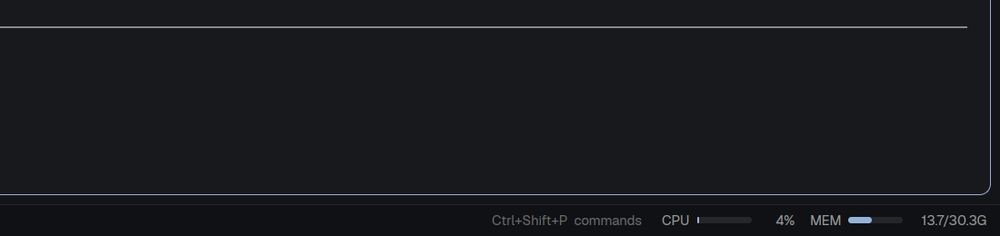

# Sysmon status

Herdr's shipped main layout with a live CPU and memory meter at the right end of the status bar. You see how busy the machine is while your agents work, without opening another window. Linux only.

## What you see

- Everything above the status bar is the shipped `main` layout (0.1.16), unchanged: sidebar with spaces and agents, tabs, the active tab's panes, and the hidden files/changes panel.
- The status bar (28px tall) is a row of two blocks:
  - left, taking the rest of the width: the shipped `workspace-status` (machine, branch, agent count, palette hint);
  - right, 300px: the `sysmon` segment.
- The `sysmon` segment uses the chrome background (`chrome`), a 1px top border (`border`), 11.8px text, 12px side padding and a 14px gap. Its contents sit at the right end. It has two meters, CPU then MEM. Each meter has:
  - the label (`CPU` / `MEM`);
  - a bar 48×6px, radius 3, track `border`, fill `accent`;
  - the value, right-aligned in a fixed-width box: CPU `37%` in 32px, MEM `13.7/30.3G` (used/total GiB, one decimal) in 68px.
- Text color follows the value: `muted` below 75%, `foreground` from 75%, `blocked` from 90%. At 90% and above, the bar fill also turns `blocked`.
- Before the first reading the value shows `--` and the bar is empty in `dim`. CPU shows `--` until the second reading, 2 s after the window opens.

## How it behaves

- It refreshes every 2 s. The bar width animates to the new value over 400ms.
- Nothing is clickable and it has no keys.
- Agent status doesn't affect it. The rest of the status bar behaves like the shipped one.
- On a machine without `/proc` (macOS, Windows), the segment is an empty strip in the chrome color.

## Built from

- **Layout:** `layouts/sysmon-status.json` is a clone of the shipped `main`. The only change is the `status` node, which becomes a row:
  `status [row, 28px]` → `status-base [block] mod:workspace-status`, `status-sysmon [block, px 300] mod:sysmon`.
- **Shipped mods used:** `workspace-chrome`, `spaces`, `agents`, `tabs`, `pane`, `files`, `changes`, `workspace-status`.
- **`mods/sysmon`:** a `View`.
  - `init` starts `cx.timer.every(2000, …)` and reads once right away.
  - Each tick reads `/proc/stat` and `/proc/meminfo` together with `readTextFile` inside `cx.spawn`, then calls `cx.notify()`.
  - CPU % = 100 × (1 − Δidle / Δtotal) between two ticks. The numbers come from the first `cpu` line of `/proc/stat`: idle = idle + iowait, total = sum of the first eight fields (user through steal). Leave out guest and guest_nice: the kernel already counts them in user and nice.
  - Memory used = `MemTotal − MemAvailable` (kB), so page cache doesn't count as used.
  - The bar fill uses `.transition("width", 400)`.
- It doesn't call `exec` or `hc`, doesn't reach the network, and reads no files other than the two under `/proc`.

## Watch out

- Give each value a fixed width. Otherwise the bars jump sideways whenever the number of digits changes, because the segment is right-aligned.
- Every `cx.notify()` redraws the whole window. Keep the interval at 2 s or longer, and animate with `.transition` rather than a faster timer.
- It reads the machine the app runs on. A space on another machine (`machine`) still shows local numbers.
- If `/proc/stat` and `/proc/meminfo` both read as `null`, treat the platform as unsupported and draw nothing, rather than showing `--` for ever.
- To support macOS or Windows, add a path that runs a program through `exec` (`vm_stat` and `sysctl` on macOS, PowerShell on Windows) and pick it from `window().platform`. That path is untested.
- 300px fits `100%` and `30.3/30.3G` at the default zoom. Widen the block for machines with over 99 GiB.

## Done when

If the mod was renamed on install (its name was taken), use the installed name below.

- `herdr-app check mods/sysmon` passes, and `layout.switch {"name":"sysmon-status"}` shows the meters at the bottom right.
- Within 4 s of switching, CPU shows a percentage and MEM's used matches `free -h`'s total minus available.
- Running `yes > /dev/null` on a few cores raises CPU within 4 s, and the bar grows smoothly.
- While the numbers change (`9%` ↔ `37%`), the bars stay in place.
- On macOS and Windows the segment is blank and nothing errors.
