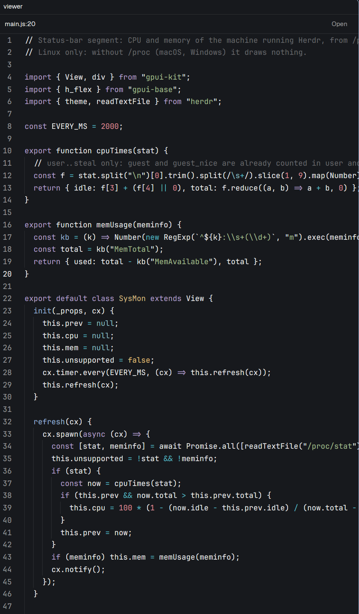

# Viewer

Ctrl-click (Cmd-click on macOS) a file path or a web address in any terminal, an agent's answer included, and it opens in a pane right beside that terminal instead of in another app: code at the clicked line, rendered markdown, images, and web pages or local `.html` files as a full-page picture you scroll through. Paths an agent prints relative to its repo, or with a Korean particle glued on (`main.js를`), are found too.

## What you see

- A pane split to the right of the clicked terminal, with Herdr's usual pane frame. A tab that already has a viewer reuses it instead of splitting again.
- **Header:** 36px tall, 12px side padding, 1px `border` bottom line, 12px text.
  - On the left: the page title, or the file name with `:<line>` when a line was clicked, or the address without `https://`. It is `foreground` and truncates.
  - On the right, as text buttons (24px tall, 8px side padding, radius 6, `muted`, `hover` background):
    - `Capturing…` in `dim` while a page is being captured.
    - `Source` / `Page`, local HTML files only.
    - `Refresh`, pages only.
    - `Browser` for pages, `Open` for files. It opens the item in the system's default app.
- **Body:** `background`, 13px text.
  - **Code and text:** Herdr's read-only editor with line numbers, syntax colors (keyword `ansi5`, string `ansi2`, comment `dim`, function `ansi4`, type `ansi3`, number `ansi1`, constant `ansi6`), and the terminal's font and size. It opens with the cursor on the clicked line.
  - **Markdown:** rendered with 24px side padding and 16px top padding. Text can be selected.
  - **Images:** centred, at their own size or narrower to fit the pane (12px padding).
  - **Pages:** the whole page as one tall picture, edge to edge, scrolling vertically.
  - **Messages** (12px, `dim`, 16px padding): `Ctrl-click a file path or a web address in a terminal.`, `Loading…`, `Capturing the page…`, `File not found`, or the helper's error.

## How it behaves

- **What a click opens:**
  - A **web address** (`http`/`https`) shows the page.
  - A **file** shows as an image (`png`, `jpg`, `gif`, `webp`, `bmp`, `svg`), as markdown (`md`, `markdown`), as a page (`html`, `htm`), or as text if its first 8 KB hold no NUL byte and it is at most 1 MiB (what Herdr's `readTextFile` reads).
  - Folders, bigger files and other binary files (PDF, archives) are passed on (`"pass"`). Herdr then opens them with its usual opener, but only if it resolved the path itself. A file the viewer found in the repo or the home folder has no opener target there.
- **Line numbers:** a path ending in `:42`, `:42:7` or `(42,7)` opens code at line 42.
- **Finding the file, in order:**
  1. The path Herdr resolved itself. A printed absolute path or `~/` path is checked as is and nothing else.
  2. The terminal's folder plus the printed path.
  3. The terminal's git root plus the printed path.
  4. The one file in that repo, tracked or untracked and not ignored, whose path ends with the printed one.
  5. The one file under the home folder whose path ends with it.

  Steps 4 and 5 open nothing when two or more files match. Step 5 skips hidden folders and `node_modules`, needs a `/` in the printed path, and stops after 4 seconds.
- **Herdr's link text can run past the path:** it glues on the Korean particle after it, or two paths and the words between them. When the text as given finds nothing, it is split on spaces. Leading quotes and brackets are dropped from each piece, as are trailing non-ASCII letters and punctuation, except a `(42,7)` line suffix. If exactly one piece is a file, that file opens. When the text as given does find a file, the other pieces are not tried.
- **Toasts instead of another app:** `File not found` when nothing matches (including a path with several suffix matches in step 4 or 5), and `Which file?` with the candidates when several pieces each match a file. Neither falls back to an external editor.
- **`file://` links** are read as local paths only when the host is empty or `localhost`. Another host stays a string that matches nothing.
- **Markdown** is reread every 2 s, so an agent's edits show up live. Other kinds reload on the next click or with `Refresh`.
- **Pages** are captured once the pane has a size, at its width minus 14px (clamped to 320–2400 CSS px). They use 2× pixels (× the app's zoom, at most 3×) so they stay sharp on HiDPI screens. Resizing the pane scales the picture; `Refresh` captures again at the new width. A capture usually takes 2–4 s; the helper gives up after 45 s.
- **Remote terminals:** a click in a terminal on another machine is passed to Herdr's usual handling.

## Built from

- **`mod.json`:** `place: "none"`, title `Viewer`, and `link_handlers`: a file rule `.` (every file) and a URL rule `^https?://`.
- **`link.js`** exports `handleLink({link, source})`:
  - It runs `node resolve.mjs <cwd> <printed path> [<Herdr's path>]` for each candidate from `kinds.js` `candidates(link.raw)`.
  - It decides the kind, then either `setShared("viewer.show", {tab, target, kind, line, n})` when `panes()` has a viewer in `source.tab`, or `pane.split {direction: "right", pane: source.pane, mod: "viewer", props: {target, kind, line, tab}}`.
  - It keeps the last 5 file clicks (raw text, Herdr's path, the terminal's folder and what was found) in `shared("viewer.clicks")` for diagnosis.
- **`main.js`** is the pane view. It reads `props()` and watches `shared("viewer.show")` in `render` for requests aimed at its tab.
  - Text and markdown: `readTextFile`, `EditorState` + `Editor`, `TextView.markdown`.
  - Images: `image()` only loads files inside Herdr's home. So `node image.mjs <src> <dir>` copies the file to `data/viewer/<copy id>/<n>/`, reads its size from the header, and prints `{file, width, height}`. An SVG's size comes from `width`/`height` or `viewBox` in its first 4 KB, else 800×600.
  - Pages: `node capture.mjs <url or path> <dir> <css width> <scale>`. It starts a headless Chrome, Chromium or Edge (`$VIEWER_CHROME`, else PATH, else the usual install folders) with a throwaway profile, and talks to it over the DevTools protocol with Node's built-in `WebSocket`.
    - It scrolls through the page once so lazy content loads, then saves `Page.captureScreenshot` with `captureBeyondViewport` in tiles of 4000 CSS px (fewer at higher scales: a tile stays under 16000 pixels) to the same `data/viewer/…` folder.
    - Pages stop at 60,000 px.
  - Cleanup: `close()` runs `node clean.mjs <its folder>`, and `init` runs `node clean.mjs data/viewer 1440` to remove copies older than a day.
- **`resolve.mjs`** and **`clean.mjs`** use only Node's standard library and `git`.
- **Programs it runs:** `node` (22 or newer, for the built-in `WebSocket`), `git`, a Chromium-family browser for pages, and the system opener (`xdg-open`, `open`, `cmd /c start`) for the header button.
- **What it reaches and reads:**
  - It reaches the network only by loading the page you clicked.
  - It reads the clicked file, `git ls-files` of the terminal's repo, and folder names under your home folder (step 5 above).
  - It writes its copies and captures under `data/viewer/` in Herdr's home, its click log and pane requests to Herdr's shared state, and the browser's throwaway profile to the system temp folder (removed after each capture).

## Watch out

- **Link handlers only work on a personal layout.** Herdr adds `"viewer"` to the shown layout's `link_handlers` the first time it sees the mod, but only on a clone, not on the shipped `main`. Clone first (`layout.clone {"name":"main","as":"my-main"}`). A script that rebuilds the clone must add `"viewer"` back to `link_handlers`, keeping any other handlers; the first matching mod gets the click.
- **Only Ctrl/Cmd-click is offered to mods.** A plain click selects text or goes to the program.
- **Bare file names (`README.md`) and backslash paths are never offered to mods.** Herdr skips them, so the agent has to print `./README.md` or `docs/x.md`.
- **What Herdr highlights on hover can be wrong next to Korean text.** The highlight is Herdr's; the viewer only cleans up what it is given.
- **A page is a picture.** Links, forms and inner scroll areas don't work, and content that only loads on interaction is missing. Use `Browser` for those, and for login pages printed by CLIs.
- Herdr doesn't tell a mod the screen's scale factor, so pages are always captured at 2× (× zoom), which costs memory on 1× screens.
- **Leftover copies:** `close()` gets 250 ms and is not called for a pane in a hidden tab, so copies can stay in `data/viewer/` until the next day's sweep.
- **Installing under another name:** the mod's own name appears in `link.js` (`mod: "viewer"`, the `panes()` filter, `mods/viewer/` helper paths), `main.js` (`mods/viewer/`, `data/viewer/`) and the shared keys `viewer.show` / `viewer.clicks`. Rename all of them, or two copies answer each other's clicks.
- **Platforms:** written for Linux, macOS and Windows, but tested only on Linux. On Linux the browser must be on PATH (or set `VIEWER_CHROME`); the install-folder search is for macOS and Windows. On Windows, Herdr doesn't offer backslash paths, so only `/` paths in terminal text work.

## Done when

- `herdr-app check mods/viewer` passes, and the shown (cloned) layout has `"link_handlers": ["viewer"]`.
- In a git repo, run `printf 'see %s:3를\n' "$(git ls-files | head -1)"` and Ctrl-click the path: a pane opens on the right with that file at line 3.
- Ctrl-click a `.md` path: it renders. Edit the file: the pane follows within 2 s.
- Ctrl-click a `.png` path: the image shows, fitted to the pane.
- `echo https://example.com` and Ctrl-click it: after a few seconds the page shows sharp and `Browser` opens it in the default browser.
- Ctrl-click a path that doesn't exist: a `File not found` toast, and no other app opens.
- Close the pane: its folder under `data/viewer/` is gone.
